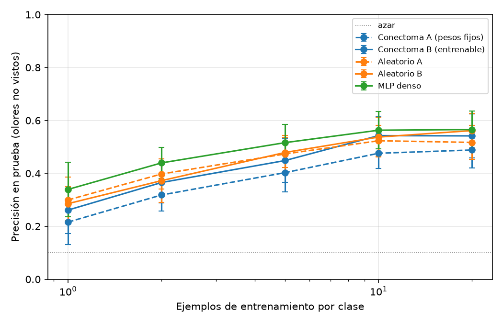
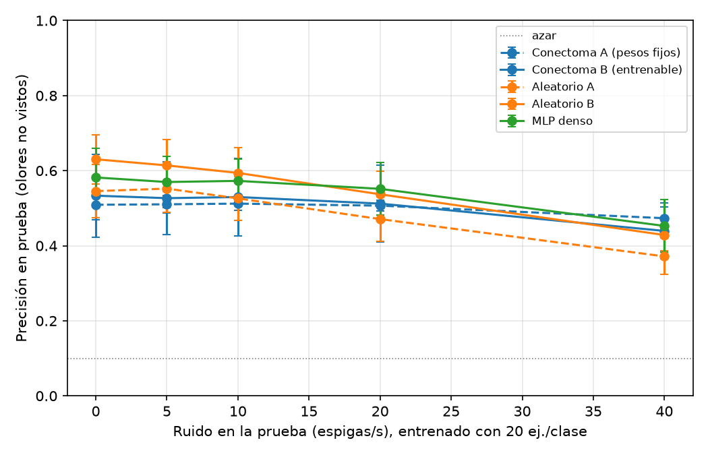

# Conectoma de la mosca como arquitectura de red neuronal

¿Importa cómo están cableadas las neuronas? Este proyecto toma el cableado real de la vía olfativa de la mosca de la fruta (*Drosophila melanogaster*, conectoma de FlyWire), lo usa como arquitectura de una red neuronal en PyTorch, la entrena para reconocer olores con pocos ejemplos y la compara con redes de cableado aleatorio y con una red densa genérica del mismo tamaño.

> **Es un experimento de arquitectura inspirado en el conectoma, no una simulación fiel de la mosca.** Usa neuronas de tasa (no de disparo) y simplifica la dopamina y la plasticidad.

**Resultado en una frase:** el cableado real **no mejora** la precisión frente a uno aleatorio con la misma densidad, y un MLP denso genérico rinde igual o algo mejor. Lo único a favor del conectoma es una mayor tolerancia al ruido cuando sus pesos están fijos. Es un resultado negativo, y se cuenta tal cual.

Web interactiva (visor 3D del circuito, animación de la señal y resultados): carpeta [`web/`](web/README.md). *Despliegue público pendiente.*

## Índice
1. [La pregunta](#la-pregunta)
2. [El circuito](#el-circuito)
3. [Datos de olores y tarea](#datos-de-olores-y-tarea)
4. [Modelos](#modelos)
5. [Resultados](#resultados)
6. [Limitaciones](#limitaciones)
7. [Reproducir](#reproducir)
8. [Estructura del repositorio](#estructura-del-repositorio)
9. [Datos, licencia y citas](#datos-licencia-y-citas)
10. [Qué queda por hacer](#qué-queda-por-hacer)

## La pregunta
¿Aporta algo el cableado concreto del conectoma frente a **(a)** una red con el mismo número de neuronas y conexiones pero cableado aleatorio, y **(b)** un MLP denso con un número de parámetros parecido?

No se compara «la mosca contra PyTorch»: todas las redes se implementan en PyTorch. Lo que se compara son **arquitecturas**.

## El circuito
Vía olfativa: receptores olfativos (ORN) → neuronas de proyección (PN) y neuronas locales inhibidoras (LN) en el lóbulo antenal → células de Kenyon (KC) del cuerpo fungiforme → neuronas de salida (MBON). Los dos hemisferios van en una sola red.

Datos: FlyWire FAFB v783 (Codex), conexiones «Filtered».

| Capa | Neuronas |
|---|---|
| ORN (53 tipos de receptor) | 2.281 |
| PN | 639 |
| LN | 422 |
| KC | 4.750 |
| MBON | 83 |
| **Total** | **8.175 neuronas, 129.600 conexiones** |

Conexiones incluidas: ORN→PN, ORN→LN, LN→ORN, LN→PN, LN→LN, PN→LN, PN→KC y KC→MBON. Quedan fuera las recurrentes ORN→ORN, PN→PN y KC→KC y las que salen de las MBON.

### Decisiones y simplificaciones
- **Neuronas huérfanas descartadas (493):** se eliminan las neuronas a las que no llega señal desde las ORN por las conexiones permitidas (46 PN, 7 LN, 427 KC y 13 MBON). Suelen ser reconstrucciones incompletas o neuronas que reciben señal por vías que no incluimos. Las ORN se conservan todas.
- **Signo (excita o frena):** viene del neurotransmisor predicho (Eckstein, Bates et al., 2024), corregido porque la predicción falla o falta en parte de las ORN y las LN.
  - ORN y KC: siempre excitadoras (son colinérgicas).
  - PN y MBON: acetilcolina excita; GABA y glutamato inhiben. MBON sin predicción: excita.
  - LN: acetilcolina excita; GABA, glutamato, y los casos sin predicción o con serotonina u octopamina, inhiben.
- **Células de Kenyon:** en los datos originales hay 5.177 (unas 2.600 por hemisferio, no ~2.000); tras descartar huérfanas quedan 4.750.
- **Posición 3D:** mediana de los puntos marcados de cada neurona. Las coordenadas de Codex están en nanómetros (con esa unidad el cerebro mide ~710 × 290 × 235 µm).
- Las ORN conectan entre hemisferios porque proyectan a los dos lóbulos antenales; el `side` de una ORN es el lado de entrada de su nervio.

## Datos de olores y tarea
- **Olores:** Tabla S1 de Hallem y Carlson (2006), con 110 olores y 24 receptores. Se usan 23 receptores, que se casan con los tipos de ORN de FlyWire por su glomérulo (tabla de Couto et al., 2005). Solo 1.121 de las 2.281 ORN (23 de 53 tipos) tienen respuesta medida; el resto recibe únicamente actividad de fondo.
- **10 clases químicas:** ácidos, acetatos, otros ésteres, alcoholes, aldehídos, cetonas, terpenos, aromáticos, lactonas y nitrógeno/azufre. Simplificaciones: los ésteres se dividieron en dos clases y las aminas se agruparon con los compuestos de azufre.
- **Partición por olores:** los olores de prueba nunca aparecen en el entrenamiento (77 de entrenamiento y 33 de prueba). Cada ejemplo es la respuesta a un olor más ruido gaussiano. Se barre 1, 2, 5, 10 y 20 ejemplos por clase.
- **Referencia:** un clasificador trivial (comparar con el promedio de cada clase) llega a 0,29 con 1 ejemplo por clase y a 0,47 con 20. El azar es 0,10.

## Modelos
Las tres arquitecturas reciben lo mismo (la respuesta de los receptores a un olor) y clasifican en las mismas 10 clases. Solo cambia cómo están conectadas las neuronas por dentro.

| Modelo | Cableado | Parámetros entrenables |
|---|---|---|
| **Conectoma A** | Real de FlyWire, pesos fijos proporcionales al nº de sinapsis. Solo se entrena KC→MBON y la capa de lectura (como en la mosca real, donde se aprende en esa etapa) | ~26.000 |
| **Conectoma B** | Real de FlyWire, todas las conexiones reales entrenables (respetando máscara y signos) | ~130.000 |
| **Aleatorio A y B** | Mismas neuronas, signos y nº de conexiones por bloque, pero entre neuronas elegidas al azar | Igual que el conectoma correspondiente |
| **MLP denso** | Todo conectado con todo, una capa oculta de 57 neuronas | ~130.000 |

El aleatorio tiene los mismos parámetros que el conectoma: solo cambia a qué neurona se conecta cada una. Por eso mide lo que aporta el cableado concreto y no la capacidad.

**Preguntas que responde:**
1. Conectoma B frente a aleatorio B: ¿importa qué neurona se conecta con cuál?
2. Conectoma A frente a aleatorio A: lo mismo, con pesos fijos.
3. Conectoma B frente a MLP denso: ¿ayuda una estructura biológica frente a una red genérica del mismo tamaño?
4. Variante A frente a B: ¿hace falta entrenar el interior de la red?

**Implementación (PyTorch):**
- `MaskedLinear`: capa lineal con peso solo donde hay sinapsis real. El signo viene de la neurona de origen y no cambia al entrenar; solo se aprende la magnitud.
- `ConnectomeNet`: ORN → lóbulo antenal (3 pasos de tiempo, con inhibición de las neuronas locales) → PN → KC (solo el 5 % más activo, *top-k*) → MBON → capa lineal hacia las 10 clases. El control aleatorio es la misma clase con el cableado barajado.
- `DenseMLP`: capa oculta de 57 neuronas, elegida para igualar los parámetros de la variante B.
- Entrenamiento: Adam, lote completo, 200 épocas fijas (sin parada temprana, porque no hay conjunto de validación). La tasa de aprendizaje (0,01; 0,003 para el MLP) se eligió con un piloto sobre semillas distintas de las del experimento.
- Decisiones propias: pesos iniciales normalizados por neurona, 3 pasos de tiempo, *top-k* global entre los dos hemisferios, y una capa de lectura MBON→clases que no existe en la mosca y es común a todos los modelos.

## Resultados
Precisión en prueba con **olores no vistos** (media ± desviación sobre 15 semillas; cada semilla cambia la partición de olores, el ruido, el cableado barajado y la inicialización). Azar: 0,10. Ruido de prueba: 10 espigas/s.

| Modelo | 1 ej./clase | 2 | 5 | 10 | 20 |
|---|---|---|---|---|---|
| Conectoma A | 0,22 ± 0,09 | 0,32 ± 0,06 | 0,40 ± 0,07 | 0,48 ± 0,06 | 0,49 ± 0,07 |
| Conectoma B | 0,26 ± 0,09 | 0,37 ± 0,08 | 0,45 ± 0,08 | 0,54 ± 0,07 | 0,54 ± 0,08 |
| Aleatorio A | 0,30 ± 0,09 | 0,40 ± 0,06 | 0,47 ± 0,07 | 0,52 ± 0,06 | 0,52 ± 0,06 |
| Aleatorio B | 0,29 ± 0,07 | 0,37 ± 0,08 | 0,48 ± 0,06 | 0,54 ± 0,08 | 0,56 ± 0,07 |
| MLP denso | 0,34 ± 0,10 | 0,44 ± 0,06 | 0,52 ± 0,07 | 0,56 ± 0,07 | 0,57 ± 0,07 |





**Lectura:**
- **Conectoma B frente a aleatorio B: empate.** La diferencia emparejada por semilla está entre −0,03 y +0,005, dentro del ruido. El cableado real no aporta precisión cuando se entrena toda la red.
- **Conectoma A frente a aleatorio A: el conectoma queda por debajo** (de −0,08 con 1 ejemplo a −0,03 con 20). Con pesos fijos, el cableado real funciona peor que uno aleatorio.
- **Conectoma B frente a MLP denso:** el MLP gana entre 2 y 8 puntos, con más claridad con pocos ejemplos.
- **Entrenar el interior (B frente a A)** da unos 5 puntos.
- **Robustez al ruido** (entrenados con 20 ejemplos, ruido de prueba 40): el conectoma A cae de 0,49 a 0,47, mientras que el aleatorio A cae de 0,54 a 0,37. Es lo único favorable al conectoma; el MLP y el conectoma B quedan en torno a 0,46.
- Las diferencias de pocos puntos están dentro del ruido. Las comparaciones no se han corregido por comparaciones múltiples.

Datos completos en `results/all.csv`, resumen en `results/summary.csv`.

## Limitaciones
- **Neuronas de tasa, no de disparo,** y la dopamina y la plasticidad están muy simplificadas. Es un experimento de arquitectura, no una simulación de la mosca.
- **Mitad de la entrada sin datos:** 30 de los 53 tipos de ORN no tienen respuesta medida y reciben solo actividad de fondo.
- **Prueba pequeña:** 33 olores de prueba; con tan pocos, diferencias de unos puntos son ruido.
- **Control aleatorio parcial:** el barajado conserva el número de conexiones por bloque y los signos, pero no el de cada neurona.
- **Decisiones propias** que podrían cambiar el resultado: capa de lectura, normalización de pesos, número de pasos de tiempo, *top-k* global, nivel de ruido y la agrupación en 10 clases químicas.
- Los datos de FlyWire se eligieron en su versión vigente de las conexiones (v783, «Filtered»); otras versiones podrían dar cifras algo distintas.

## Reproducir
Requisitos: Python 3.11 o superior con [uv](https://docs.astral.sh/uv/), `pdftotext` (paquete poppler-utils) y Node 22.23 o superior para la web. Todo se ejecuta desde la raíz del repositorio. Las instrucciones detalladas están en [`src/flyconn/README.md`](src/flyconn/README.md) (Python) y [`web/README.md`](web/README.md) (web).

**1. Datos.** Descarga de [FlyWire Codex](https://codex.flywire.ai/api/download) (requiere aceptar sus condiciones) los archivos `classification.csv.gz`, `connections_princeton.csv.gz`, `neurons.csv.gz`, `coordinates.csv.gz` y `consolidated_cell_types.csv.gz` en `data/raw/`. Descarga también el suplemento de Hallem y Carlson (2006), `mmc1.pdf`, en `data/raw/hallem_carlson/`. `data/raw/` no se sube a git.

**2. Pipeline.**
```bash
uv sync                                              # entorno
uv run python -m flyconn.data.build                  # subcircuito en data/processed/
uv run python -m flyconn.data.hallem                 # tabla de respuestas de olores
uv run python -m flyconn.train --override "seeds=[0,1,2,3,4,5,6,7,8,9,10,11,12,13,14]" out_csv=results/all.csv
uv run python -m flyconn.evaluate --csv results/all.csv    # tabla y gráficas
uv run python -m flyconn.export                      # JSON para la web
uv run pytest -q                                     # 20 tests
```
El entrenamiento corre en CPU y tarda del orden de 20 a 30 minutos por cada 5 semillas (según la máquina). Todo es reproducible: depende solo de las semillas.

**3. Web.**
```bash
cd web && npm install && npm run dev                 # http://localhost:4321
```

## Estructura del repositorio
```
configs/        experimento (default.yaml), clases de olores y mapa receptor→glomérulo
data/raw/       descargas de FlyWire y Hallem (no se sube a git)
data/processed/ subcircuito en Parquet y tabla de olores
src/flyconn/    código Python: data/, models/, train.py, evaluate.py, export.py
notebooks/      exploración inicial de los datos
tests/          pytest
results/        resultados de los experimentos y gráficas
web/            visualizador (Astro + React + Tailwind + three.js)
CITATIONS.md    citas y condiciones de uso de los datos
```

## Datos, licencia y citas
Los datos de FlyWire se usan bajo **CC BY-NC 4.0** (solo uso no comercial, con atribución) y los términos de servicio de FlyWire. El sitio web derivado también debe mantenerse **no comercial** y conservar la atribución.

Citas obligatorias: Dorkenwald et al., 2024, *Nature*, y Schlegel et al., 2024, *Nature*. Además se citan Zheng et al. 2018, Yu et al. 2025 (sinapsis), Eckstein, Bates et al. 2024 (neurotransmisores) y Codex. Respuestas de receptores: Hallem y Carlson, 2006, *Cell*. Mapa receptor→glomérulo: Couto, Alenius y Dickson, 2005, *Current Biology*. Lista completa con enlaces en [CITATIONS.md](CITATIONS.md).

El código de este repositorio aún no tiene licencia asignada.

## Qué queda por hacer
- Desplegar la web en Netlify.
- Variante con conexiones recurrentes (PN→PN, KC→KC) y con la neurona APL en lugar de *top-k*.
- Entrenar cada hemisferio por separado y comprobar si el resultado se repite.
- Control aleatorio que conserve también el grado de cada neurona.
- Fase 2 del visualizador (mallas reales de neuronas) y fase 3 (API en vivo con FastAPI).
